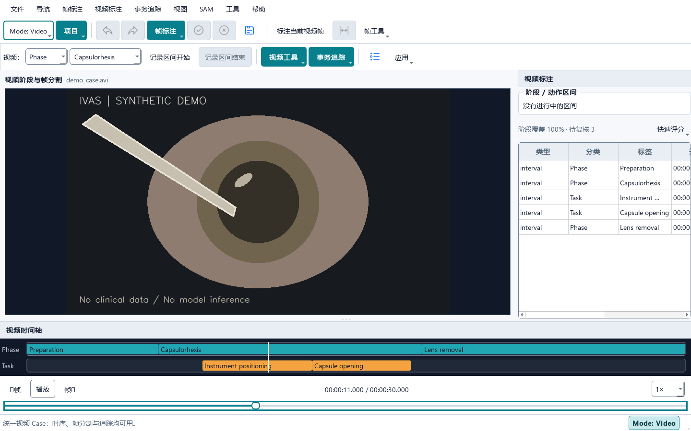
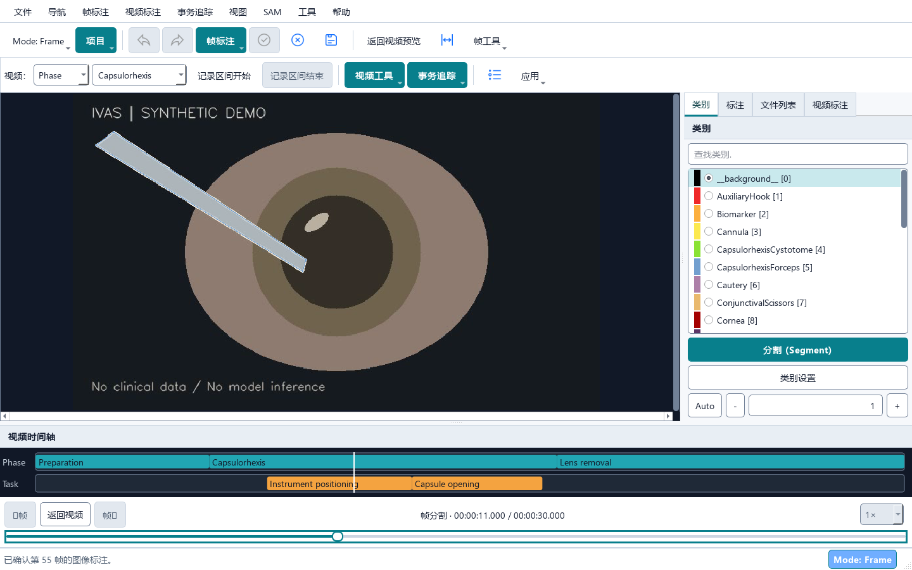
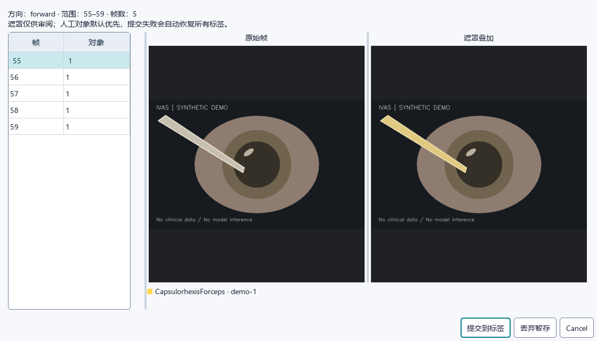
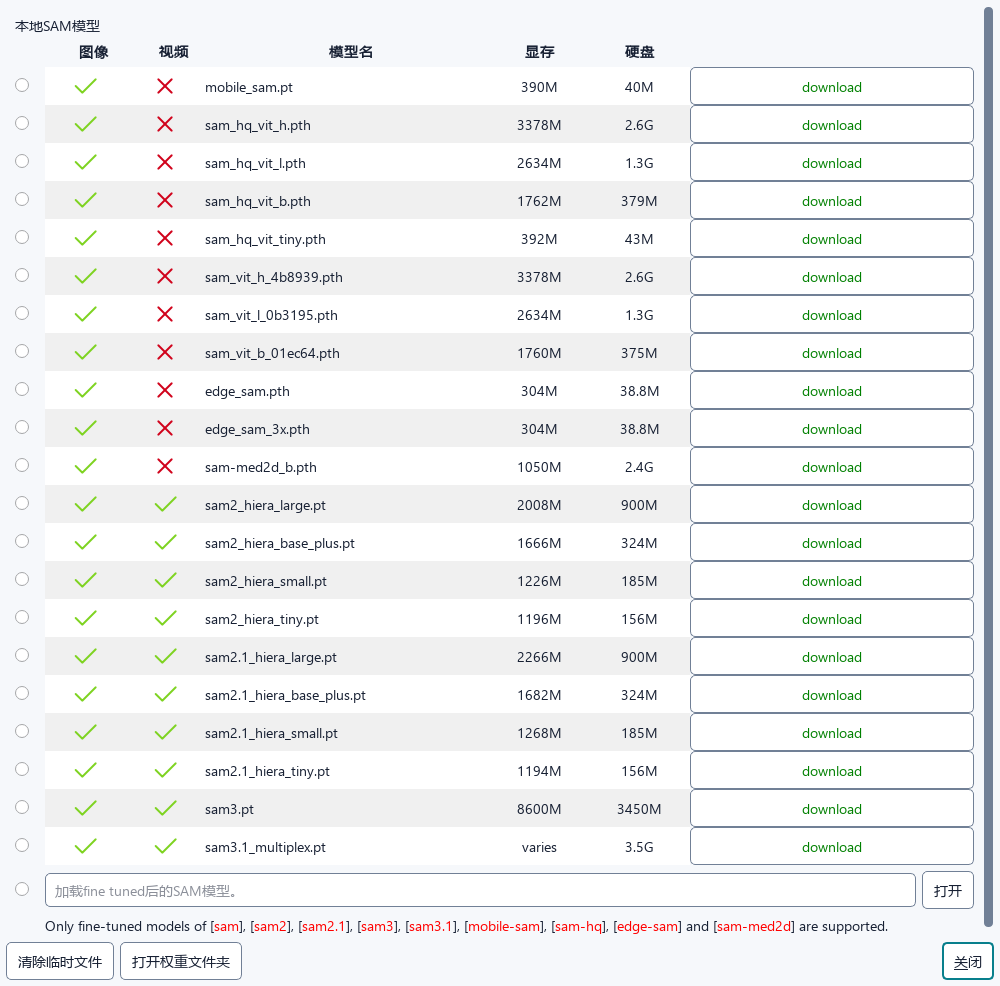
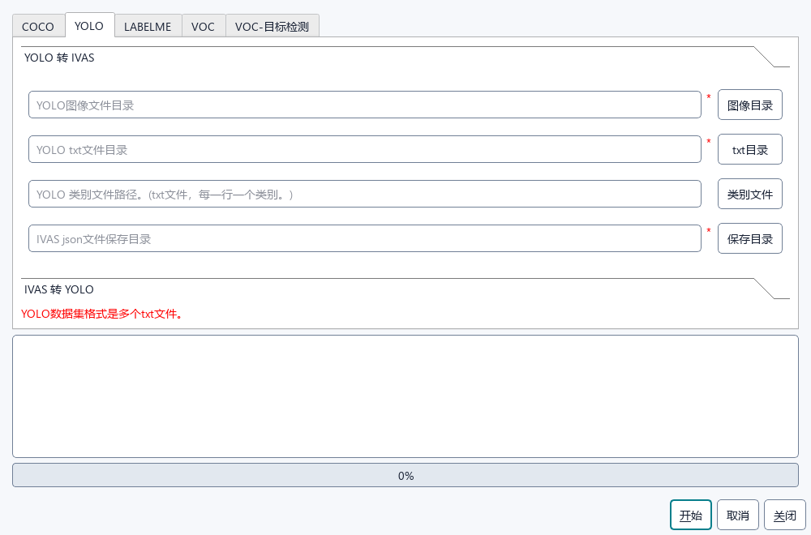

<p align="center"></p>

<h1 align="center">Surgical Phase & Tool Annotation · IVAS</h1>
<p align="center">手术视频阶段、动作与器械分割标注工作台</p>
<p align="center">Python · PyQt5 · Segment Anything · 维护者 zack zhao</p>

IVAS 将手术视频的时间标注和单帧器械分割整合到同一个桌面项目：在 **Video** 模式记录 Phase / Task 区间，在 **Frame** 模式精修器械或组织轮廓，再通过视频追踪将已标注对象传播到其他帧。阶段标注与手工分割均可独立使用；启用 AI 分割或追踪时再加载相应模型。

## 主要功能

| 工作流 | 支持的操作 |
| --- | --- |
| 视频阶段与动作 | Phase / Task 双轨时间轴、区间起止、时间点与关键帧、评分、备注、模板、覆盖率检查和审核状态 |
| 器械与组织标注 | 手工多边形、旋转框、轮廓编辑、类别与实例管理、图层、语义 / 实例预览 |
| AI 辅助分割 | SAM 系列模型；按模型能力提供点、框、视觉及文本提示；支持 Original / BF16 / FP16 / FP32 精度设置 |
| 视频对象追踪 | 兼容的 SAM2 / SAM3 / SAM3.1 模型，多帧修正、向前 / 向后 / 双向传播，先暂存审核再提交，支持回滚 |
| 项目与数据交换 | 统一视频项目、帧图像与 JSON 标签分开保存；视频 CSV / TXT 交换；COCO、YOLO、LabelMe、VOC 等图像标注转换 |
| 桌面使用 | 中英文界面、可停靠面板、快捷键、自适应布局、可选 VLC 解码后端、Windows 便携版构建 |

## 关键界面与功能说明

以下截图来自当前项目的实际 Qt 界面。画面、区间和器械掩码均为合成演示数据，用于说明操作位置；掩码由人工预设，不代表模型推理结果。

### 1. 视频阶段与动作标注



- **顶部 Mode / 项目**：切换 Video 与 Frame，管理项目输出目录；通过“文件”打开视频或已有视频项目。
- **视频标注工具栏**：选择 `Phase` 或 `Task` 和标签，在播放位置记录区间开始与结束。视频控件获得焦点时可用 `I` 开始、`O` 结束。
- **中央预览与底部播放条**：播放 / 暂停、前后逐帧定位、调整速度；时间码用于精确查看标注边界。
- **底部双轨时间轴**：上轨显示 Phase，下轨显示 Task；支持缩放、平移和选择已有区间，便于检查阶段覆盖与动作重叠。
- **右侧视频标注面板**：列出标签、开始 / 结束时间和状态，显示覆盖率及待审核数量；可继续编辑备注、评分和审核状态。

### 2. 当前视频帧的器械分割



- **进入帧标注**：点击“标注当前视频帧”或选择 `Mode → Frame`，提取播放位置对应帧，进入图像画布；编辑时播放位置固定。
- **中央分割画布**：绘制多边形、调整轮廓和顶点，也可加载模型后使用点 / 框等提示辅助分割。图中浅色轮廓为演示器械的人工标注。
- **右侧类别 / 标注 / 文件列表**：查找并选择器械或组织类别，管理当前帧的对象、实例分组和图层；类别可按任务自定义。
- **保存与返回**：按 `Ctrl+S` 保存帧 JSON，点击“返回视频”继续阶段标注。未完成的 Phase / Task 区间会保留，帧标签与时序标注各自保存。

语义和实例显示用于检查结果；编辑轮廓时需要回到标签显示。

### 3. 视频追踪结果审核



通过“事务追踪”设置范围和方向，在兼容模型上运行对象传播；完成后打开暂存结果审核窗口：

- **左侧帧列表**：选择需要检查的结果帧，查看该帧涉及的对象数量。
- **中间原始帧 / 叠加预览**：对照原画面与彩色掩码，检查器械边界、漏分割和对象身份；图例标明类别与追踪 ID。
- **底部操作**：“提交到标签”写入正式帧标注，“丢弃暂存”删除本次待提交结果，“取消”关闭审核窗口。

追踪结果在审核前保持暂存；提交默认保留人工对象，失败会恢复标签，已提交的追踪运行可回滚。截图使用人工构造的暂存结果演示审核流程。

### 4. SAM 模型管理



通过 `SAM` 菜单打开模型管理，查看模型是否支持 **Image / Video**、显存与磁盘需求，并下载或选择权重。绿色勾号表示支持该类任务；普通图像分割模型不一定支持视频追踪。

模型精度在设置中选择，具体提示方式取决于模型。下载权重放在 `IVAS/checkpoints/`；权重不随 Git 仓库分发。仅做阶段标注时无需加载模型。

### 5. 标注格式转换



通过“工具”中的格式转换器，在 COCO、YOLO、LabelMe、VOC 等页签中选择输入图像、标签路径及输出目录，执行与 IVAS JSON 的转换。不同目标格式可表达的信息不同，转换后应抽查类别、实例及轮廓。

此窗口处理**图像标注**；视频时序标签的 CSV / TXT 导入导出位于“视频标注”菜单。

## 安装与启动

建议使用 **Python 3.11** 和独立环境。当前 Windows 开发环境使用 Python 3.11；模型推理还需要与本机驱动匹配的 PyTorch，显存需求以所选模型为准。

```powershell
git clone https://github.com/AIEyeSystem/Surgical_PhaseTool_Annotation.git
cd Surgical_PhaseTool_Annotation
python -m venv .venv
.\.venv\Scripts\python.exe -m pip install --upgrade pip
.\.venv\Scripts\python.exe -m pip install -e .
.\.venv\Scripts\python.exe main.py
```

也可在激活环境后使用 `ivas` 或 `ivas-sam` 启动。Linux / macOS 的虚拟环境解释器为 `.venv/bin/python`；桌面运行需要图形环境。

视频默认使用 Qt Multimedia。遇到 Qt 无法解码的视频，可安装与 Python 位数一致的 VLC 桌面运行库，程序会尝试 VLC 后端；仅安装 `python-vlc` 并不包含 VLC 原生运行库。

### 第一次标注

1. 在“项目”中设置新视频项目的输出目录，再从“文件”打开视频。
2. 在 Video 模式选择 Phase / Task 标签，播放或逐帧定位，用起止按钮创建区间；按需设置模板、备注、评分和审核状态。
3. 需要标注器械时，在目标时间点点击“标注当前视频帧”，进入 Frame 模式，选择类别并绘制轮廓；AI 辅助功能需先加载模型。
4. 保存帧标注后返回视频。需要跨帧传播时，选择兼容模型，运行追踪并检查暂存结果，再提交。
5. 保存视频项目，并按需导出时序 CSV / TXT 或转换图像标签格式。

只处理独立图像时，通过“文件”打开图像目录，在 Frame 模式完成标注即可。

## 数据保存与快捷键

一个视频病例的输出目录通常包含：

```text
<输出目录>/<视频名>_<标识>/
├── project.ivas.json       # 视频、时序标签、模板、帧引用和追踪记录
├── frames/                 # 提取的视频帧
├── labels/                 # 帧级器械 / 组织标注 JSON
├── tracking/               # 追踪暂存与相关资产
└── exports/                # 保存项目时同步的 CSV / TXT 导出
```

重新打开标注时选择 `project.ivas.json`。迁移项目应保留病例目录内的帧、标签和追踪资产；原视频路径变化后，通过项目菜单重新关联媒体。

| 场景 | 默认快捷键 | 操作 |
| --- | --- | --- |
| 通用 | `Ctrl+S` | 保存当前工作 |
| 视频控件获得焦点 | `Space`、`←` / `→` | 播放 / 暂停、前后逐帧 |
| 视频控件获得焦点 | `I` / `O` | 记录区间开始 / 结束 |
| 视频控件获得焦点 | `Ctrl+Z` / `Ctrl+Shift+Z` | 撤销 / 重做时序标注操作 |
| 图像画布 | `C`、`Q`、`W` | 手工多边形、SAM 点提示、SAM 框提示 |
| 图像画布 | `E` / `Esc` | 完成 / 取消绘制 |
| 图像画布 | `A` / `D`、`F` | 上一张 / 下一张、适应窗口 |

快捷键可在设置中调整；Frame 与 Video 按当前编辑区域分配按键。旧版 `project.ivat.json`、`ivat.yaml` 和 `ivat.plugins` 入口仍兼容；新文件使用 IVAS 命名。

## Windows 便携版构建

当前构建脚本使用 Conda 前缀式 `.venv/python.exe`。与上面的标准 venv 启动方式不同，打包需要单独准备该环境；脚本在缺少环境时会尝试克隆本机已有的 `labeling` Conda 环境，再补齐 `requirements-portable.txt` 及构建依赖。

```powershell
# 需要本机已有 labeling Conda 环境，并使用 Conda 前缀式 .venv
conda create --prefix .\.venv --clone labeling --copy --yes
.\build_portable_exe.ps1 -SkipCheckpoint

# 若要打包 SAM3.1，将 sam3.1_multiplex_bf16.pt 放在项目根目录后执行
.\build_portable_exe.ps1
```

如果已按源码启动步骤建立标准 venv，请在另一份检出目录准备打包环境。输出为 `build/IVAS/IVAS.exe`；分发时需要整个 `build/IVAS/` 文件夹及其 `_internal/` 内容。也可双击 `build_exe.bat` 调用构建脚本。

## 开发与仓库内容

```text
IVAS/               应用入口、界面、标注格式、SAM 适配和视频项目逻辑
docs/images/        README 使用的关键界面截图
example/            原项目随附的示例素材
test/               标注、项目保存、界面与追踪回归测试
tools/              截图与功能验证工具
build_exe.spec      Windows 打包配置
```

在已安装依赖的环境运行现有测试：

```powershell
python -m unittest discover -s test -p "test_*.py"
```

重新生成上述演示截图：

```powershell
python tools/capture_readme_screenshots.py
```

`.gitignore` 排除了虚拟环境、模型权重、构建目录、日志缓存、本地数据 / 标注输出、参考项目和本机凭据；应用源码、模型 YAML 配置、打包脚本和 `docs/images/` 截图纳入版本管理。`IVAS/software.yaml` 是随附默认配置，本地类别文件 `IVAS/ivas.yaml` 由程序管理。

更多界面与保存边界说明见 [工作流审计](docs/annotation-workflow-audit.md)。问题反馈请使用[本仓库 Issues](https://github.com/AIEyeSystem/Surgical_PhaseTool_Annotation/issues)。

## 许可证与致谢

本项目基于 [ISAT with Segment Anything](https://github.com/yatengLG/ISAT_with_segment_anything) 扩展，当前应用名称为 **IVAS**，维护者为 **zack zhao**。保留上游版权及第三方代码声明，项目许可见 [LICENSE](LICENSE)。模型权重和第三方组件遵循各自的许可条款。
